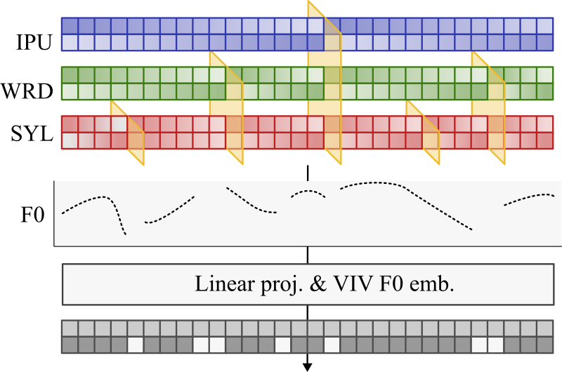
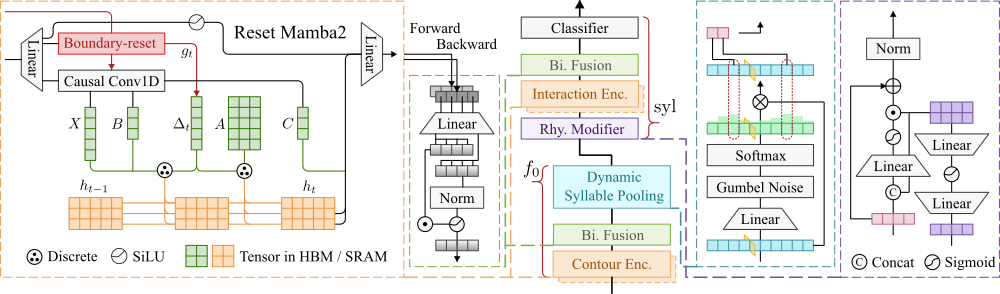

# ToneMamaba: Learning Contextualized Tonal Contours with Boundary-Reset State Space Models

[](https://creativecommons.org/licenses/by-nc-sa/4.0/)

<div align="center">
  
</div>

<br>

<div align="center">
  
</div>


## Dataset input

Preprocessed data is downloaded automatically from
[poyu39/FCU_Voice_47_EX](https://huggingface.co/datasets/poyu39/FCU_Voice_47_EX)
and cached by Hugging Face. Raw recordings are not required.

```text
FCU_Voice_47_EX/
├── csv/reset/
│   ├── train_filtered.csv
│   ├── val_filtered.csv
│   └── test_filtered.csv
└── f0/
    ├── f0_praat.csv
    └── f0_praat.npy
```

| Split | Usable IPUs | Evaluated syllables |
| --- | ---: | ---: |
| train | 1,132 | 5,328 |
| val | 123 | 568 |
| test | 314 | 1,327 |

Requires Linux x86_64 and an NVIDIA CUDA GPU. Python and dependencies are managed by uv.
The dataset is private; authorized users must first run `uv run hf auth login`.

```bash
uv sync --locked
uv run infer.py --output predictions.csv
uv run infer.py --mode single
```

Defaults to the test split with packing (80,000 F0 frames per batch).
Use `--token-batch-size 20000` to change the limit; longer IPUs run alone.
Use `--split val` to change splits or
`--sample-index 0` to run one usable IPU (inter-pausal unit).
Use `--data-dir PATH` to load local artifacts instead.

## Output

Packing outputs CSV with one row per syllable. Single prints each IPU's predictions,
reference tones and probabilities to the terminal.
`--output` applies to packing only. Accuracy is printed to stderr.

| Field | Meaning |
| --- | --- |
| `split`, `sample_id` | Dataset split and sample ID. |
| `syllable_index` | Zero-based syllable index within the IPU. |
| `tone` | Predicted tone 1–5; 5 is neutral tone. |
| `reference_tone` | Reference label; blank when excluded from evaluation. |
| `prob_1`–`prob_5` | Probability of each tone. |

Syllables with fewer than 5 valid F0 frames have blank predictions and probabilities
in CSV, or `-` in the terminal.

## Architecture and checkpoint

Model class: `ToneNetResetBiMamba2WithRhythm`. Parameters are defined in
[tone_mamba/config.py](tone_mamba/config.py); defaults match the bundled checkpoint.

| Component | Configuration |
| --- | --- |
| Model width | 256 |
| Contour / interaction layers | 8 / 4 |
| Head dimension / state size | 32 / 64 |
| Expansion / convolution width / chunk size | 2 / 4 / 256 |
| Contour reset levels | IPU, word, syllable |
| Interaction reset levels | IPU, word |
| Rhythm features | 9 channels: syllable, final and vowel duration features |
| Parameters | 5,447,239 |

Shared-weight bidirectional Mamba-2 encoders, gated fusion, dynamic syllable
pooling and a rhythm modifier. The FCU_Voice_47_EX fine-tuned weights are stored
in `checkpoints/model.pt` (20.83 MiB).

## Validation

Validated on 2026-09-15: BF16 inference on an RTX 5090 evaluated
1,327 syllables across 314 test IPUs:

| Mode | Correct syllables | Accuracy |
| --- | ---: | ---: |
| packing (80,000 frames) | 1,273 | 95.93% |
| packing (20,000 frames) | 1,274 | 96.01% |
| single | 1,274 | 96.01% |

BF16 predictions can differ slightly with batch layout. Both modes preserve
sample order and syllable indices.
Remote download and offline cache reuse were verified.

Details: [checkpoints/validation.md](checkpoints/validation.md).

## License

This project is licensed under the
[Creative Commons Attribution-NonCommercial-ShareAlike 4.0 International License](https://creativecommons.org/licenses/by-nc-sa/4.0/)
(CC BY-NC-SA 4.0). See [LICENSE](LICENSE) for the full terms.
